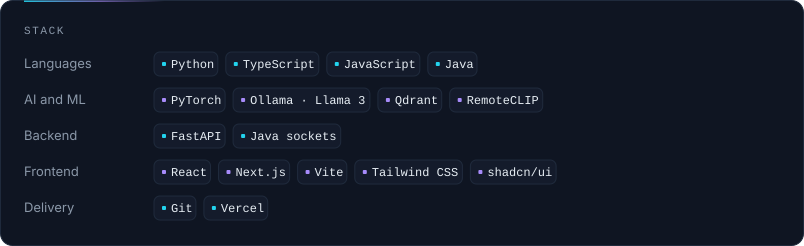

<!--
  Profile README for github.com/mradul-grit.
  Cards under raw.githubusercontent.com/.../output/ are regenerated by
  .github/workflows/profile.yml and published to the `output` branch.
  Edit profile.config.json, not the cards. Setup: docs/SETUP.md
-->

<picture>
  <source media="(max-width: 600px)" srcset="https://raw.githubusercontent.com/mradul-grit/mradul-grit/output/hero-compact.svg" />
  
</picture>

<p align="center">
  <a href="#featured-work">Featured&nbsp;work</a>&emsp;&emsp;<a href="#activity">Activity</a>&emsp;&emsp;<a href="#progression">Progression</a>&emsp;&emsp;<a href="https://github.com/mradul-grit?tab=repositories">All&nbsp;repositories</a>
  <!-- Add more links when ready, for example:
  &emsp;&emsp;<a href="https://www.linkedin.com/in/YOUR-HANDLE">LinkedIn</a>
  &emsp;&emsp;<a href="mailto:you@example.com">Email</a>
  -->
</p>

```ts
const mradul = {
  role: "AI + full-stack developer",
  focus: [
    "multi-agent AI systems",
    "computer vision",
    "full-stack web apps",
  ],
  now: ["structor_ai", "snakegame"],
  recent: "SIH 2026 hackathon",
};
```

## Featured work

<p align="center">
  <a href="https://github.com/mradul-grit/NetSentinel-AI"></a>
  <a href="https://github.com/mradul-grit/SIH-2026"></a>
  <a href="https://github.com/mradul-grit/structor_ai"></a>
  <a href="https://github.com/mradul-grit/snakegame"></a>
</p>

## Stack

<p align="center">
  <picture>
    <source media="(max-width: 600px)" srcset="assets/stack-compact.svg" />
    
  </picture>
</p>

## Activity

<p align="center">
  
  
</p>
<p align="center">
  <picture>
    <source media="(max-width: 600px)" srcset="https://raw.githubusercontent.com/mradul-grit/mradul-grit/output/activity-compact.svg" />
    
  </picture>
</p>

<p align="center">
<picture>
  <source media="(prefers-color-scheme: dark)" srcset="https://raw.githubusercontent.com/mradul-grit/mradul-grit/output/snake-dark.svg" />
  <source media="(prefers-color-scheme: light)" srcset="https://raw.githubusercontent.com/mradul-grit/mradul-grit/output/snake.svg" />
  
</picture>
</p>

<!-- LeetCode: set "leetcode.username" in profile.config.json, then uncomment.
<p align="center">
  
</p>
-->

## Progression

<p align="center">
  
  
  
  
</p>

<details>
<summary><b>How the XP and achievements are calculated</b></summary>

<br />

This is my own progression system, not a GitHub feature. Level, XP and achievements are computed from GitHub API data by [`scripts/profile_cards/gamify.py`](scripts/profile_cards/gamify.py). Quests are goals I set myself, so they never count as achievements.

| Source | XP |
| :--- | ---: |
| Contribution on the calendar (max 12 per day) | 3 |
| Day with at least one contribution | 5 |
| Pull request opened | 20 |
| Pull request review | 15 |
| Issue opened | 8 |
| Public, non-fork repository | 40 |
| Star on those repositories | 10 |
| Repository owned by someone else that I opened a PR to | 30 |

Reaching level *L* takes `50 × L × (L − 1)` XP. Full rules: [docs/XP_RULES.md](docs/XP_RULES.md).

</details>

<br />

<p align="center">
  <sub>The cards are rebuilt daily by GitHub Actions, and each one shows when it was last updated. The 3D skyline is re-rendered in Blender every Monday.</sub>
  <br />
  <sub><a href="#">Back to top</a></sub>
</p>
